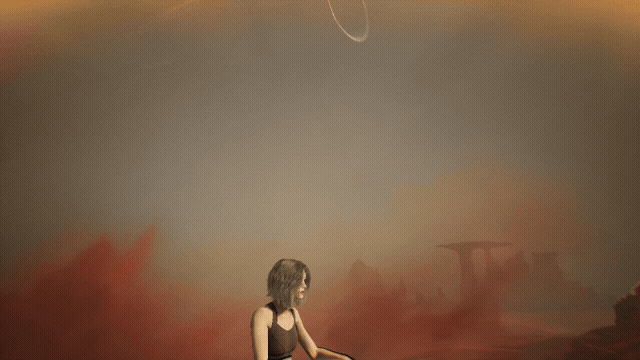
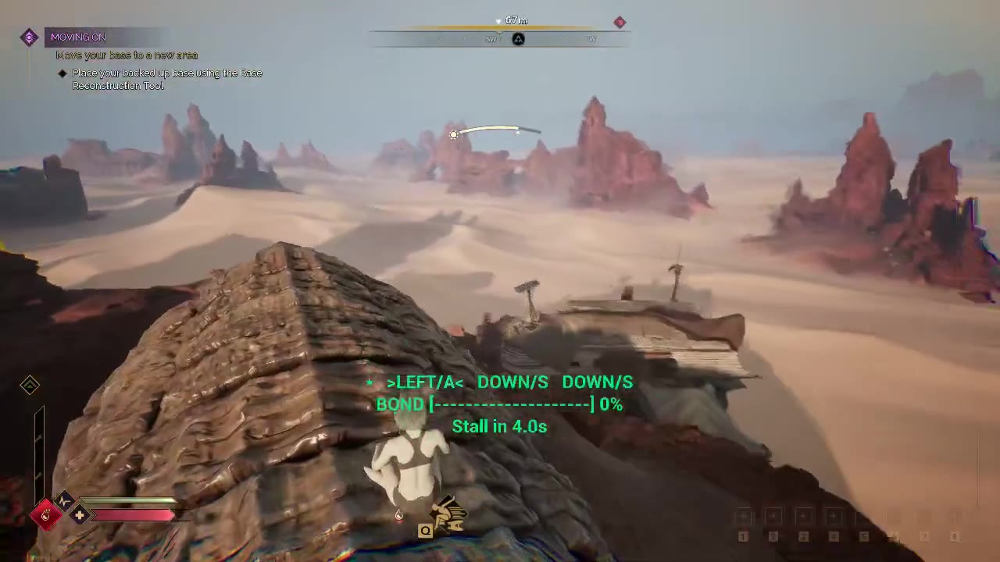

# Worm Rider — Tamer of Shai-Hulud

**Hook, tame and ride the sandworms of Arrakis in Dune: Awakening (Solo).**



▶ [Watch the 12-second clip](media/worm-rider-demo.mp4)
https://www.reddit.com/r/PassthroughMods/comments/1xkdsqg/comment/19rxu0x9b9281/?utm_source=share&utm_medium=web3x&utm_name=web3xcss&utm_term=1&utm_content=share_button

Taming works like ARK: Survival Ascended's Concavenator. Fire your Shigawire Claw at an approaching worm, get reeled onto its back, then survive the wild ride by matching the arrow prompts until the bond bar fills. Stall too long and Shai-Hulud throws you off. Once it's tamed, it's yours to steer.



## Features

- **Shigawire Claw mount.** You play the game's own claw throw, a wire shoots out to the worm, you're reeled in along an arc and land on its neck.
- **Concavenator-style taming.** Match the arrow keys or W/A/S/D. A wrong key restarts the sequence; running out of time throws you off.
- **Ride your worm.** Surge, slow, steer, breach-leap and dive to sand-surf. Land arrow tricks while diving to charge a speed boost.
- **Sit on its neck.** You ride cross-legged behind the head, rise and dip with the body and turn as the head turns.
- **Get off and call it back.** Your worm waits where you leave it. Call it to you and climb back on.
- **Nothing from the game is shipped.** The worm model, animations and wire material all load from your own install.

## Requirements

- Dune: Awakening on Steam (PC), update 1.5 or later, played in **Solo**.
- That's all: the UE4SS mod loader is included in the release download.

> **Solo only.** Mods load only in a Solo session started without BattlEye. The launcher adds the loader for that session and removes it when the game closes, so normal Steam launches (online, with BattlEye) stay untouched. Mods never run on official or private servers.

## Install

1. Download `WormRider-x.y.z.zip` from [Releases](../../releases).
2. Extract it so the `WormRider` folder sits inside your game folder, usually
   `C:\Program Files (x86)\Steam\steamapps\common\DuneAwakening\WormRider`.
3. Double-click **`Play Worm Rider.bat`**, then pick **Solo** on the main menu.

If the game ever crashes and you want to be sure the loader is gone, run **`Remove Loader.bat`**.

## How to play

| Step | What to do |
|---|---|
| Lure | Walk on open sand (or plant a thumper) until a worm comes. The screen shows its distance from 500 m away. |
| Ready your hook | Press **G**. Hold your ground; when the worm comes within 70 m, your claw fires automatically. |
| Tame | Press the keys shown, in order (arrows or W/A/S/D). Fill the bond bar 8 times. |
| Ride | **W/S** speed, **A/D** steer, **Space** breach, hold **Shift** to dive. Arrow tricks while diving charge a boost. |
| Dismount | **G**. Your worm waits. **H** calls it, **G** climbs back on when you're close. |

**While riding**

| Key | Action |
|---|---|
| Home / End | Sit higher / lower on the worm |
| PgUp / PgDn | Raise / lower the visible worm body |
| F6 | Show / hide the control list |
| F7 | Try other sitting poses your game has loaded |
| F8 | Hide / show the visible worm body |

## Known limits (v0.1)

- Your tamed worm lasts for the play session; it isn't saved.
- The real worm stays deep under the sand. What you see and ride is a copy of its body, made from the worm model in your game, that follows its animation. Its height is adjustable (PgUp/PgDn) and set in `sheets/config.json`.
- Sandstorms still hurt you while riding.
- The game can remove a worm at any time (for example, when you cross into another region). The mod then drops you safely.

## How it works

Worm Rider is a UE4SS Lua mod (`mod/WormRider/Scripts/main.lua`).

- **Finding the worm:** it finds the game's sandworm pawns (`BP_Crea_SandwormArrakis_C`) and pauses their AI while you ride. It keeps the AI controller attached, because detaching it crashes the game when the worm has an attack queued.
- **Moving you both:** the mod steers the worm across the sand and seats you on the copy's `neck_03` bone, facing `head_01`.
- **Animations and wire:** the claw throw, the reel-in and the cross-legged pose are the game's own animations, found by path in the game's pak index (see `tools/utoc_dirs.py`). The wire is the engine's basic cylinder stretched thin, in the game's Shigawire material.
- **Staying safe:** the mod listens for the game's own "object ending" event (EndPlay), so it never touches a worm the game has deleted.

### Built from sheets

Every class, function, key, number, message, animation and bone the mod uses lives in a JSON sheet in `sheets/`. Each row becomes one Lua table in the generated `mod/WormRider/Scripts/sheets.lua`. Change the sheet, not the code.

```bash
python3 tools/build.py preflight   # every cell filled, every reference resolves, every row used
python3 tools/build.py generate    # preflight, then write sheets.lua
pip install lupa && python3 tests/run.py   # headless play-through against a UE4SS mock (92 checks)
python3 tools/package.py           # build dist/WormRider and the release zip
```

`tools/package.py` needs the tested UE4SS runtime in `third_party/` (see [third_party/README.md](third_party/README.md)).

## Credits

- **UE4SS** (RE-UE4SS) by the UE4SS contributors, MIT License: the Lua scripting runtime, bundled in the release.
- **UE4SS Dune: Awakening game configuration** (zCustomGameConfigs), MIT License.
- The tested runtime and the Solo launch approach (`-nobattleye`, `--ue4ss-path`, restore-on-exit) follow **DST – Dune Server Tool** ([coastal-ms/DST-DuneServerTool](https://github.com/coastal-ms/DST-DuneServerTool)).
- The taming design is inspired by the Concavenator in ARK: Survival Ascended (Studio Wildcard). No ARK content is used.

Dune: Awakening is © Funcom and its licensors. Worm Rider is an unofficial, free, non-commercial fan mod, not affiliated with or endorsed by Funcom. No game files are included.

## License

[MIT](LICENSE) — remixes welcome.
